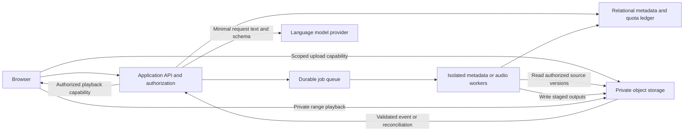

# Proposed cloud architecture

## Status and design objective

This is a discovery proposal. No cloud service, resource, deployment configuration or runtime schema is implemented by this document. The objective is a private, inspectable library with bounded media processing, portable artifacts and low operational burden.

Prefer a modular application service over multiple independently deployed business microservices. Separate the media workers because their memory, duration and isolation requirements differ from the API. Preserve the independent playlist and DJ engine packages; the host application owns accounts and storage, and adapters translate tenant-scoped source records into each package's contracts.

## Logical components and trust boundaries

The direct arrow to storage is conditional on an authenticated capability. No bucket is public. If an authenticated media gateway is later inserted, its cache authorization becomes part of the security boundary. Queue events never independently establish that a source belongs to a tenant.

## Platform alternatives

| Topology | Advantages | Costs and limits | Disposition |
|---|---|---|---|
| Managed Postgres/auth + thin API + object store + container workers | Clear data model, lower operations, independent media sizing | Multiple services and authorization bridge; fixed minimums | Proposed default |
| Mostly serverless API + managed jobs | Cheap idle web control plane; scalable dispatch | Runtime limits, cold starts, retries and vendor coupling | Suitable control plane, benchmark workers |
| Single VM with API and worker | Simple initial topology, transparent resource bill | Noisy neighbors, patching, disk exhaustion, recovery/on-call burden | Only bounded internal spike |
| Kubernetes/many microservices | Fine resource scheduling at demonstrated scale | High coordination and operational overhead | Deferred |
| Consumer bring-your-own storage | Existing customer files may reduce upload | OAuth, quotas, revocation, sync conflicts and terms | Separate later adapter |
| Local-first plus selective cloud | Lower initial transfer and rights exposure | Fewer remote features; later sync design | Reopen if cloud demand/upload gates fail |

Supabase is a candidate for managed metadata/auth, not an accepted dependency. A managed Postgres/auth choice paired with R2/B2 needs server-side ownership checks for every signed capability. RLS in one service does not secure another service's objects. AWS or Google managed jobs may be candidates, but cloud credits and selected region remain unknown.

Lambda documents a 900-second limit. Cloud Run documents a longer job envelope, including a separate GPU limit. These establish topology constraints, not a reason to choose a vendor without a resource benchmark. [AWS limits](https://docs.aws.amazon.com/lambda/latest/dg/gettingstarted-limits.html) S025; [Cloud Run jobs](https://docs.cloud.google.com/run/docs/configuring/task-timeout) S026.

## Data ownership and storage layout

Use a tenant-scoped random logical ID for every library, source, track and artifact. Never expose a content hash as a global lookup endpoint. Hashes are integrity/cache identifiers within an authorized scope and can reveal that a file exists if exposed across tenants.

Proposed object roles:

| Role | Write rule | Retention proposal |
|---|---|---|
| Quarantined upload | Server-generated unique key, upload-only capability | 24h after abandonment, adjustable before pilot |
| Verified original | Immutable key per source version | Until explicit deletion, subject to disclosed backup policy |
| Browser derivative | Immutable source hash + profile version | Retain while referenced; regenerate if safe/economic |
| Analysis artifact | Source/version/tool manifest | Retain current plus supported history under quota |
| Mix master | Plan/input/environment identity | Default 30 days proposed; user may retain within quota |
| Compressed mix export | Master hash + encoder profile | Same expiry as master unless explicitly extended |
| Temporary worker scratch | Job-only access; local ephemeral disk | Remove on completion/failure; janitor catches crash residue |
| Backup | Separate access and retention policy | Proposed 30-day window; test deletion tombstone replay |

All durations are proposals requiring product, legal and cost reconciliation. Early deletion must remove access immediately even if a provider still bills minimum retention. No source file is overwritten to update tags. Application metadata overlays preserve the original container bytes.

A DB transaction cannot atomically commit to object storage. Use staged artifacts, verified checksums, immutable keys and a final database publication transaction. A reconciler finds orphan objects and missing references. Only published states may serve playback.

## Upload implementation design

Reserve expected bytes and file count before signing. Limit single-file bytes, total batch bytes, concurrent sessions and cumulative in-flight parts. A valid MIME header is not proof of audio content. Parse media only in a constrained worker with bounded decode duration, output size and external protocol restrictions.

For small MP3s, a single PUT may be simplest. For larger files, use direct multipart with server-tracked upload ID and parts. Candidate part size is 8–32MiB, with total concurrency initially 2–4; tune from memory and network measurements. Track part ETags only as provider part identities. Compute and independently verify full-file SHA-256 before acceptance. [Multipart reference](https://docs.aws.amazon.com/AmazonS3/latest/userguide/mpuoverview.html) S020.

Do not materialize a multi-gigabyte file in browser or API memory. Browser hashing must use a tested incremental approach with bounded memory. SHA computation has real CPU/time cost. A browser restart may require reselecting the file; match size plus full content identity before trusting an existing upload session. Path/name/mtime alone are insufficient integrity proof.

TUS is a mature alternative when a managed service supplies it. Avoid running an additional TUS proxy solely to add a protocol name: it may route all bytes through paid compute. Evaluate integration and billing together. [TUS](https://tus.io/protocols/resumable-upload) S021; [Supabase TUS](https://supabase.com/docs/guides/storage/uploads/resumable-uploads) S022.

Incremental import is append-only by default. Same tenant and same verified bytes can reuse a source object while preserving multiple logical folder references. Changed bytes create a new source version. Missing files in a later folder selection do not trigger cloud deletion. Bidirectional sync and automatic deletes are deferred.

## Playback design

Serve tested MP3 originals using private HTTP ranges first. Probe codec/container before declaring eligibility. FLAC/WAV and other files can retain originals while producing a pinned browser-compatible derivative after authorization. Choose a single derivative profile from listening and device tests; do not transcode lossy MP3 unnecessarily.

Range handling must preserve Content-Length, Content-Range, Accept-Ranges, MIME type and status semantics. Test HEAD, 206, 416, suffix and open-ended ranges, missing ranges, short files, expired links and reauthentication mid-track. Apply origin CORS deliberately; CORS is not authorization. [Range requests](https://developer.mozilla.org/en-US/docs/Web/HTTP/Guides/Range_requests) S023; [audio codec guidance](https://developer.mozilla.org/en-US/docs/Web/Media/Guides/Formats/Audio_codecs) S024.

Use private cache controls initially. If a CDN is justified, authorize before a cached response and prove tenant separation, object revision isolation and deletion propagation. Do not rewrite R2 presigned URLs onto custom domains. [R2 signing](https://developers.cloudflare.com/r2/api/s3/presigned-urls/) S012.

Playback loudness normalization is an optional gain overlay with headroom, separate from rewriting originals and from mix mastering. Waveform previews should be compact amplitude summaries with explicit parameters, not retained full decoded PCM.

## Analysis and render workers

Split stages: integrity/probe → optional standardized measurement → optional licensed estimation → catalog publication. Browse/playback must not wait for expensive rhythm analysis when it is unnecessary. Record each stage's input hash, output hash, tool/model version, parameters, time, peak memory, warnings and failure category.

The current Apple Silicon MLX path is an experiment baseline, not a generic Linux image. Candidates are a pinned CPU implementation, a pinned Linux/GPU upstream implementation or later hosted Apple hardware. Require comparative accuracy, cost and RAM measurements before changing any local engine model/fold/demix. D031's hold remains applicable.

Pin the exact approved FFmpeg build and inspect dependency/model licenses. Limit threads, subprocess counts, wall time, RAM, scratch bytes and source duration. A large source can expand many times when decoded. Reject malicious or pathological inputs before heavy work where possible.

Rendering consumes a validated plan and an explicit approved job. It cannot access arbitrary paths/URLs from a proposal. Download only authorized immutable sources into job scratch; resolve source identities through the application. Emit staged output and manifest, verify duration/hash/loudness/true peak, then publish. A process exit code of zero alone is not quality acceptance.

Queue delivery may duplicate. Use a stable logical job key derived from tenant, operation, source/plan hashes, profile and version. Track attempts separately. A lease/fencing token prevents an old worker from publishing after cancellation or a newer attempt. Payment/quota ledger entries have independent idempotency keys.

## Development and deployment workflow

Proposed repository boundary: future cloud host directory with its own lockfile and configuration, explicit dependency on versioned package artifacts, and no import of desktop Tk UI or local shell configuration. Location is not created until implementation is authorized. Existing Python packages remain independently testable.

Local loop: fake auth plus local relational database and an object-store test double using generated fixtures. It validates application contracts, not provider parity. Staging: isolated account/project, disposable tenants, synthetic/licensed fixtures, tight budget cap, provider-specific contract tests. Production: separate credentials, storage and DB with reviewed IaC and a deployment log.

Use pinned dependencies, reproducible worker image digests, secret injection, migration review and an SBOM/model manifest. CI first validates contracts and unit boundaries, then bounded integration tests. Heavy or real-audio runs are opt-in with explicit caps. Never run the preserved corpus automatically.

Deploy changes behind separate upload, playback, analysis, playlist and mix feature flags. Use additive DB migrations and backward-compatible jobs until the old worker queue drains. Roll back application image/flags before attempting destructive schema rollback. A decoder/analysis upgrade creates a new artifact version; do not silently relabel historical outputs.

## Exit and scale triggers

Keep provider-specific code behind a small object adapter: initiate/sign/list/complete/abort upload; stat/read/delete object; create read capability. Do not build a universal storage framework before the first provider is proven.

Export includes originals, logical hierarchy, playlists, annotations/provenance, job manifests and checksums. Test import into a blank test tenant with preserved logical relationships. Search starts with relational indexed filters and full-text fields; add embeddings/vector search only when relevance experiments justify it. Add dedicated queue/service tiers only when measured queue age, utilization or tenant fairness requires them.
