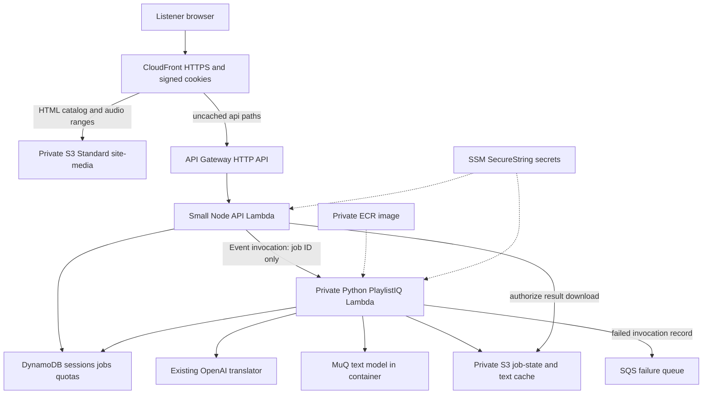

# Serverless architecture and behavior

2026-10-02. Proposed implementation; existing VM tests do not validate these integrations.

## Playback is independent of AI

CloudFront fetches immutable MP3 ranges directly from multi-AZ S3 and caches them near listeners. There is no audio byte proxy through API Gateway, Lambda, the Mac or an always-on VM. The browser resolves catalog track IDs to hash-addressed media paths; generating a playlist merely chooses IDs already in that catalog. Existing mixes remain immutable media. [Range behavior](https://docs.aws.amazon.com/AmazonCloudFront/latest/DeveloperGuide/RangeGETs.html).

A worker outage, quota exhaustion or OpenAI failure disables new AI results, not an already authorized library. Manual playlists and favorites remain browser-local. No cloud song analysis, conversion, rendering or uploads from guests.

## Shared access, distinct browser sessions

Keep one owner-controlled listener password initially. Public `/login/` contains only login assets; no song names/audio. API checks its bcrypt hash and issues (a) host-only CloudFront signed cookies and (b) a random application session cookie backed by DynamoDB. Use Secure, HttpOnly, SameSite=Lax, Path=/ and 24-hour expiry. POST requires the exact configured HTTPS Origin plus a CSRF token. Each browser receives its own session despite the shared password.

Use a **new RSA-2048 or ECDSA-P256 CloudFront signing key**, not the prepared RSA-4096 SSH key; CloudFront's supported key types differ. Store the private key in SSM; only the API role can retrieve it. Publish only the public key into a trusted CloudFront key group. The app shell is public so first-time visitors can reach login; its entry cookie-expiry check is navigation, not authentication. Built-in CloudFront verification protects catalog/media at the edge without invoking Lambda on each range request. No IP restriction in cookie policy because mobile IPs change. [Signed access](https://docs.aws.amazon.com/AmazonCloudFront/latest/DeveloperGuide/private-content-overview.html), [cookies](https://docs.aws.amazon.com/AmazonCloudFront/latest/DeveloperGuide/private-content-signed-cookies.html).

The app begins at `/login/index.html`, completes authentication, then navigates to protected `/index.html`. The API renews cookies ahead of expiry; playback recovers from an expired cookie by renewing once and retrying the range request. With API unavailable, existing cookies work until expiry; new login/renewal will not. Individual API sessions can be revoked immediately; already issued CDN cookies remain valid until expiry unless the signing key is revoked for everyone. Shared-password coarse revocation is an explicit v1 limitation.

The API also verifies a CloudFront-origin secret header, overwritten/set by CloudFront, so direct execute-api calls fail. This is additional protection; every private API route still checks the session and ownership. Do not treat CORS as authentication. All API responses, including Set-Cookie and failures, are noncacheable. Do not use a global CDN 403-to-index fallback that could conceal failed media authentication.

## Asynchronous request contract

1. Browser POSTs prompt, up to three clarification answers, chosen estimator profile, selected published IDs/hashes, release ID and client-generated idempotency token. Limit JSON to 64 KiB and prompt to 4,000 characters; never submit raw features/audio.
2. API validates membership against the published IDs, normalizes request identity, and stores the request under an immutable private S3 job key. A DynamoDB transaction creates the session-owned job, increments daily and monthly counts once, and reserves one of at most three outstanding job slots. Duplicate token plus different payload returns conflict; same payload returns the same job.
3. API sends a tiny `InvocationType=Event` message to the private worker alias. Return HTTP 202 only after AWS accepts dispatch. If dispatch fails, persist `dispatch_failed` and release the slot once. If the API crashes after dispatch but before recording success, retry the same job; duplicate delivery is expected and handled by a conditional worker claim. A persisted record alone is not proof that work was queued.
4. Worker atomically claims the job, confirms release/model/image identities and obtains the canonical selected catalog from the frozen planner. It calls the original OpenAI translator and MuQ text path, then ranks locally. No estimated browser metadata is trusted.
5. Write full replay/audit privately, store browser-safe result separately, then conditionally mark the job succeeded/needs-clarification and release its slot. Persist result first so a successful state never references a missing object. Failures are sanitized; paid-provider-started ambiguity is recorded rather than silently repeated.
6. Browser polls every two seconds initially, backing off to five seconds with jitter and pausing in the background. Each status lookup checks session ownership and logical expiry. Completion returns a result URL signed by S3 for 60 seconds; fetch it and normalize into the current PlaylistRun shape. This avoids Lambda's response-size ceiling. Restrict job-state CORS to the one CloudFront origin, GET/HEAD only, and use no-store objects; a signed URL is a short-lived bearer capability.

DynamoDB state machine: `dispatching → queued/running → succeeded | needs_clarification | dispatch_failed | failed | expired | outcome_unknown`. Late worker completion must match its claim and an unexpired state; it cannot resurrect an expired job or release a slot twice. Store timestamps, session hash, request digest, release ID, result key, attempt/claim identity, provider-call-started marker, error category and TTL; no raw embeddings/prompt in the small row. Store requests/results in S3, not a large DynamoDB item.

Native async delivery may duplicate requests. **At-most-one logical paid attempt is the application goal, not an AWS exactly-once guarantee.** Claim before provider work; do not automatically rerun a job after an ambiguous paid call. Explicit user retry creates a new counted attempt. Lambda function-error retries are zero; infrastructure/throttling retries and duplicate delivery still need the claim. OnFailure goes to an SQS Standard queue containing only job references and sanitized invocation metadata. [Async retry behavior](https://docs.aws.amazon.com/lambda/latest/dg/invocation-async-error-handling.html).

With maximum event age 600 s plus function timeout 360 s, use a conservative job deadline 1,020 s. Status/admission reconcile expired outstanding slots with conditional writes, so a timed-out worker cannot permanently block the next request. Do not rely on DynamoDB TTL deletion for correctness; it may lag days. Never mark a still-valid lease expired simply because a browser disconnected. [TTL](https://docs.aws.amazon.com/amazondynamodb/latest/developerguide/TTL.html).

## Availability boundaries and proposed acceptance targets

| Failure | Expected behavior |
|---|---|
| MuQ/OpenAI timeout or prompt cap reached | New AI job fails or is rejected; authenticated catalog/audio/manual playlists remain available |
| API/DynamoDB/SSM outage | Existing CDN cookies and static media continue; login/renewal/new jobs unavailable |
| Cold worker | UI shows queued/running; no effect on streaming; no advertised instant AI response |
| S3 regional problem | Cached media may work, uncached objects can fail; no promised cross-region failover |
| CloudFront or network outage | Playback can fail; retry/resume UI, no absolute uptime claim |
| Bad release | Reject identity mismatch, retain previous assets/image/pointer and roll back |

Planning targets, to be measured: cached audio first-byte p95 under 1 s and uncached under 2 s from the intended Peru/mobile connection; seeking succeeds; control API response p95 under 2 s warm; whole PlaylistIQ p95 under 45 s warm and 120 s cold. These are acceptance goals, not current measurements or provider SLAs. Failure prompts an explicit latency/cost tradeoff, not an automatic paid upgrade.
