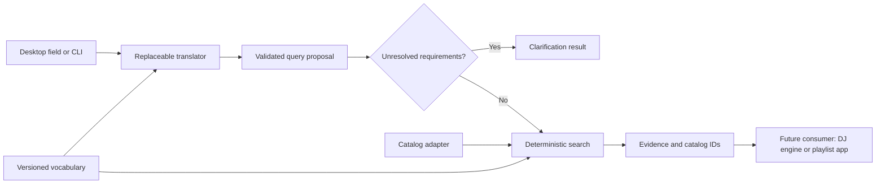

# PlaylistIQ architecture

PlaylistIQ is the product name. The technical package, command, import, and
`prompt-playlist/*` schema identifiers remain unchanged.

Parent D058 names Resonant as the future consumer: it may persist/reorder the
returned candidates, play the resulting playlist and package eligible files.
Those host actions are outside this pipeline. In particular, source playability
does not become download authority and PlaylistIQ never receives archive or
render tools.

## One small pipeline

The translator never sees the catalog. It emits criteria, not track IDs to
include, functions to invoke, or rendering operations. The service makes one
interpretation call, checks the proposal and applies the deterministic query.
This boundary **lets us audit why each track matched**: a result retains the
validated query, matched/missing evidence, provenance, versions, digests, and
stable IDs instead of accepting an unexplained model-selected list.
Consumers wanting their own agent loop can expose the three read-only tools
in `tools.py`; this package does not need an agent framework to perform its
fixed pipeline. A future host must translate these generic tool schemas into
its provider's tool-envelope format and maintain its own call budget.

## Modules and change points

| Module | Responsibility | Replace when |
|---|---|---|
| `models.py` | Strict serializable contracts and bounds | Consumer contract changes |
| `vocabulary.py`, `descriptors.json` | Canonical tag IDs and exact aliases | Descriptor taxonomy changes |
| `translators.py` | Prompt → validated proposal | Provider or prompt policy changes |
| `search.py` | Deterministic filtering, ranking, ID lookup | Retrieval strategy changes |
| `tools.py` | Discoverable schemas and explicit dispatch allowlist | An agent host needs tools |
| `service.py` | Translate once, clarify or search | Workflow changes |
| `adapters.py` | Native JSON and read-only DJ artifact import/export | Music data source changes |
| `folder_catalog.py` | Bounded local metadata/hash import and source manifest | Folder metadata source changes |
| `analysis_models.py` | Strict descriptor and performance contracts | Extraction schema changes |
| `model_assets.py` | Pinned model URLs, hashes and bounded cache | Model selection/version changes |
| `analysis_worker.py` | One algorithm on one track in an isolated process | Feature algorithm changes |
| `analysis_pipeline.py` | Discovery, safety, telemetry, checkpoints, projections and reports | Analyzer orchestration changes |
| `config.py`, `playlist.toml` | Explicit project profile and credential references | Host/model/catalog changes |
| `live_check.py` | Explicit six-request live smoke evaluation | Evaluated requirements change |
| `cli.py`, `desktop.py` | Input/output only | Interface changes |

Beat This 1.1 reads through Torchaudio first. With Torchaudio 2.11, file loading
requires TorchCodec; PlaylistIQ deliberately uses Beat This's lighter SoundFile
fallback instead. `soundfile` is therefore an explicit `analysis` dependency
and preflight check, not an accidental transitive package. Resume accepts and
migrates the original 0.3.0 checkpoints that predate the recorded SoundFile
version so unrelated successful stages are not recomputed.

The JSON vocabulary is deliberately small. Add canonical `axis:value` entries
with descriptions and unique aliases, bump its identity, and supply it with
`--vocabulary`. Unknown IDs and ambiguous aliases fail validation. Catalog
tags must belong to the active vocabulary; synonym resolution never runs
fuzzy matching or embedding search. Reuse requires no graph, database or
microservice. Add another adapter only when a second real consumer needs it.

## Evidence and matching

Hard filters are AND constraints: every required tag, each numeric bound,
all excluded IDs, and every negative-tag check must hold. Positive matches
require a `passed` or `warning` annotation. A missing tag is unknown, not false.
To prove absence of an excluded tag, a catalog author must declare its axis
complete. Rejected/unknown annotations on that axis invalidate that coverage
for exclusion checks. Completeness is a catalog-author assertion; search does
not verify the annotation process.

Preferences are soft. Equal-weight preferred-tag coverage determines score;
required-only searches score eligible candidates 1; unconstrained/numeric-only
queries score 0 because no tag preference is being measured. Scores are not
probabilities or quality ratings. Relevance ties use ascending track ID. BPM
ordering uses usable BPM with unknown last, then relevance and ID. No random
sampling, half/double tempo reinterpretation, inferred mood, automatic query
relaxation, or harmonic sequencing occurs.

Full-track durations are retained as evidence for consumers, but the service
does not promise a set duration: trimmed playback, overlap and transition
planning belong to a downstream planner. Selection output is intentionally
incompatible with the renderer's `MixPlan`; integration must explicitly
resolve IDs and construct/validate segments and transitions later.

## Natural-language desktop boundary

The desktop always presents a natural-language OpenAI workflow. It must not
expose the offline grammar as the user’s description format. `playlist-query-v3`
makes a direct single-genre request a required filter and ordinary mood/energy
a soft preference unless explicitly mandatory. “DJ set” alone is contextual;
actual mixing operations and duration promises remain unsupported. The query
schema and deterministic search algorithm are unchanged by this policy.

A light Tk layout shows request entry, plain-language criteria and track
results, with optional detailed provenance. Missing requested preference
evidence stays visible without opening those details. No browser framework,
web server, UI library or new runtime package is introduced. Provider failures
remain errors, not an invitation to write grammar.

## Reproducibility and operational bounds

Results include catalog/vocabulary digests, the validated query, ranking
version and a result digest. The result ID hashes the complete result except
its own ID using canonical UTF-8 JSON; catalog ordering changes its snapshot
digest even if sorted match order stays the same. The original prompt and
provider/model/prompt version are saved in the enclosing run. Identical stored
queries replay deterministically; repeated live model calls need not agree.
No timestamps or random IDs are added to deterministic output.

Prompt input is limited to 4,000 characters; results and lookups to 100 tracks;
tag constraints to 50 per list; one API call per request; default network
timeout 30 seconds; response size 1 MiB and model output 4,096 tokens. There
are no automatic retries. The desktop worker keeps UI access on the main
thread; only one request is active per window. Closing a window exits the
daemon worker's host process; it is not a provider-side cancellation guarantee.

Native catalogs are trusted user-supplied data, with strict structure and
semantic validation at use boundaries. This is a local prototype, not a
multi-user service or a catalog index benchmark. Public tool dispatch denies
unknown operations and extra arguments. Provider refusals, incomplete responses,
invalid JSON, invented tags and contradictory bounds produce explicit errors.
Prompt injection or omitted requirements cannot be disproved by schema checks;
interpretation must be evaluated independently on real language prompts.

The DJ adapter checks hash/ID consistency in the saved artifact only. It never
opens audio or verifies files on disk. Corpus hash checks in the experiment
log are separate explicit development verification. JSON export refuses
overwrites and music/media destinations, including existing symlink targets.

The folder adapter is separately authorized for the 120-file pool. It hashes all
selected files, runs sequential bounded FFprobe metadata reads, then hashes all
files again and compares directory inventory. No audio models or PCM renders
run. The manifest keeps source paths, aliases, hashes, raw imported fields and
unmapped genre strings; the compact catalog still omits paths. Genre mappings
are exact, case-insensitive aliases, splitting explicit comma/semicolon/slash
lists after trying the full alias. No genre hierarchy or mood inference occurs.
Embedded tags do not establish axis completeness. Probe failures are explicit;
source mutation prevents CLI catalog publication and leaves a diagnostic manifest.

Project configuration is explicit through `--config` for CLI data commands.
The desktop also discovers `playlist.toml` in the current directory, then
in an editable package checkout, after honoring explicit `--config`. It does
not search unrelated ancestor directories or change library behavior. Explicit
catalog/vocabulary/provider flags override profile values; desktop rules mode
is rejected. Generic CLI `prompt` defaults to OpenAI and needs configured
credentials/model, while developer rules parsing requires `--provider rules`.
Library callers always pass a translator. `Open Playlist.command` selects
the checked-in profile explicitly.
The profile pins a model and names a credential source without holding a key.
The credential reader prefers only the named environment variable, otherwise
reads one literal assignment from the explicitly configured file. It never
sources/evaluates shell code or expands variables. API errors omit raw provider
response bodies. Neither catalog, paths, audio nor credentials enter prompt text.
The OpenAI authorization header is the only network use of the key.

## Dependency choice

Only Pydantic is required for search, translation, and the UI. Standard-library HTTP provides a small
isolated OpenAI adapter; `Translator` is a Python protocol suitable for local
models or another provider. Tkinter is optional and loaded only by `ui`; CLI
and imports work on systems without it. The wheel includes the default
vocabulary. DJ analyzer versions and its lockfile are independent.
Folder import optionally requires the installed FFprobe executable; imports,
search and the UI do not need it after the catalog snapshot exists. The
explicit `analysis` extra pins Beat This, `essentia-tensorflow`, PyTorch,
Torchaudio, NumPy and psutil. FFmpeg/FFprobe remain host
executables. All-In-One MLX is absent. Analysis models live in a verified local
cache and are never package-data or core-runtime dependencies.

## Implemented descriptor-extraction boundary

The current folder adapter is metadata-only and must stay that way. The resumed
second-test direction adds a separate `analyze-folder` command, not hidden work
inside prompt translation. It reads one explicitly selected folder and writes a
versioned descriptor run, reports, work files and checkpoints outside it.
Workers are sequential and short-lived; source identity and full inventory are
checked before/after. All-In-One is excluded. See
[`AUDIO_FEATURES.md`](AUDIO_FEATURES.md) for selected/deferred fields, candidate
models, future commercial-viability notes, and the evaluation gate.

The extraction artifact deliberately is not a catalog and does not change
search behavior. Raw model outputs, estimates, warnings and telemetry remain
available for threshold/accuracy review. A later adapter may create a new
catalog snapshot, but must preserve source identity, probability provenance,
abstention, and the structured reason trail.

Local `--resume` reads checkpoints from the current output. Repeatable
`--reuse-from PRIOR_OUTPUT_DIR` supports a distinct corpus output without
overwriting the prior report: the prior descriptor must have passed both source
preservation gates, and each imported stage must match the current audio
SHA-256, pipeline version, algorithm, tool versions, model hashes, and requested
CPU-thread configuration. Compatible results are copied atomically into the new
checkpoint directory; incompatible or absent entries are recomputed. Filename
equality alone never authorizes reuse.

## Planned retrieval-comparison boundary

After the descriptor artifact is stable, a separate experiment may compare the
structured baseline with CLAP audio–text similarity, TF-IDF/BM25 over normalized
descriptor documents, lightweight text embeddings of those documents, and a
hybrid structured-filter-plus-similarity ranker. None belongs inside audio
analysis or prompt translation. Each is a versioned retrieval adapter consuming
the same immutable descriptor snapshot and returning scores/provenance suitable
for replay and comparison. The structured eligible set and explanation record
remain available even when learned similarity participates in ranking.

## 2026-09-19 — PlaylistIQ Iteration 1 delivered

Python 0.4.0 / player 0.3.0 now integrate `playlist-intent-v1.3` (configured low reasoning), `intent-compiler-v1.1`, `maest-intent-v1` ranking and `discogs-parents-v1`. Required genres use MAEST support; creative prompts use directional soft priorities. Genre OR/family matching, original-request clarification, per-track contributions and twenty-prompt review evidence are available. New result/catalog/translation/run writes use schema 0.2.0 and read historical 0.1.0.

422 Python tests and 50 web tests pass. Final compiler replay passes all 20 intent/constraint checks; live revision failures are preserved, and final optional/HTTP checks pass. Human listening acceptance remains pending. No new audio analysis or cloud work; YAML is still a consideration task.

See [implementation, prompt, contracts and verification](ITERATION_1.md). This current checkpoint supersedes older descriptions of v3-only translation, flat genre ties and missing parent matching; dated older sections remain historical evidence.

## 2026-09-25 — Selectable supervised feature estimators

Music2Emo (MERT-95M + BTC/chord/key + J_all, corrected mode) and MusiCNN danceability are implemented as optional direct-feature challengers. The specialist reference remains default; MAEST top-six, MuQ and ranking weights are preserved. Complete compatible catalog coverage is required per challenger; otherwise everyone retains the reference. Two authorized sources passed six matched-window stages and zero-inference retries. Final checks: 481 Python tests, 80 web tests, 45 JS syntax modules, 28-file build, 40 exact fixed-query replays and one final successful live replay. One prior live intent proposal was rejected; no new listening judgments or superiority claim.

Exactly two local cache records have both challengers. Original Chrome was observed at 109 unique tracks; its final updated display was not confirmed because native interaction was interrupted by active use. The new reload migration attaches richer same-hash optional caches to completed reference records. Isolated browser acceptance verified real values, retry, profile/scope, saved-result reopening, App Status and 390/320px controls. No batch/new-corpus inference, audio upload, cloud work, commit or format migration.

Read [research, commands, failures, coverage and continuation](SUPERVISED_ESTIMATORS.md). Historical sections/publication cutoffs below remain evidence for their original dates.

## 2026-09-25 — Quality-first estimator research and implementation

Quality-first non-genre research and the selected available specialists are delivered locally. The web default selects Music2Emo theme/VA, MusiCNN vocals, VGGish aggression and independent PaSST OpenMIC instrument evidence, retaining EffNet happy/sad/relaxed/danceability. SheetSage2 supplies selected key evidence. MAEST, MuQ and planner weights remain unchanged. Two authorized sources passed 8/8 new stages; retries execute zero stages. Richer nuanced-emotion prediction and listening superiority remain unresolved; do not present encoder-only releases or the same 56 tags as solving that objective.

[Implementation, two research reports, setup, model contracts and verification](TOP_ESTIMATORS_IMPLEMENTATION.md). Final validation: 502 Python tests, 83 web tests, 45 syntax modules, 28-file build, eight successful final audio stages and 26 exact fixed-query replays. No new provider calls or listener judgments. The new optional specialist stages and quality/openmic vocabulary identity preserve reference records and saved-profile replay.
