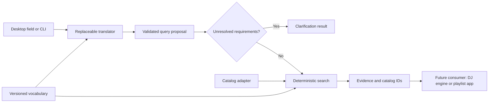

# Architecture

## One small pipeline

The translator never sees the catalog. It emits criteria, not track IDs to
include, functions to invoke, or rendering operations. The service makes one
interpretation call, checks the proposal and applies the deterministic query.
Consumers wanting their own agent loop can expose the three read-only tools
in `tools.py`; this package does not need an agent framework to perform its
fixed pipeline. A future host must translate these generic tool schemas into
its provider's tool-envelope format and maintain its own call budget.

## Modules and change points

| Module | Responsibility | Replace when |
|---|---|---|
| `models.py` | Strict serializable contracts and bounds | Consumer contract changes |
| `vocabulary.py`, `descriptors.json` | Canonical tag IDs and exact aliases | Descriptor taxonomy changes |
| `translators.py` | Prompt → validated proposal | Provider or prompt policy changes |
| `search.py` | Deterministic filtering, ranking, ID lookup | Retrieval strategy changes |
| `tools.py` | Discoverable schemas and explicit dispatch allowlist | An agent host needs tools |
| `service.py` | Translate once, clarify or search | Workflow changes |
| `adapters.py` | Native JSON and read-only DJ artifact import/export | Music data source changes |
| `folder_catalog.py` | Bounded local metadata/hash import and source manifest | Folder metadata source changes |
| `config.py`, `playlist.toml` | Explicit project profile and credential references | Host/model/catalog changes |
| `live_check.py` | Explicit six-request live smoke evaluation | Evaluated requirements change |
| `cli.py`, `desktop.py` | Input/output only | Interface changes |

The JSON vocabulary is deliberately small. Add canonical `axis:value` entries
with descriptions and unique aliases, bump its identity, and supply it with
`--vocabulary`. Unknown IDs and ambiguous aliases fail validation. Catalog
tags must belong to the active vocabulary; synonym resolution never runs
fuzzy matching or embedding search. Reuse requires no graph, database or
microservice. Add another adapter only when a second real consumer needs it.

## Evidence and matching

Hard filters are AND constraints: every required tag, each numeric bound,
all excluded IDs, and every negative-tag check must hold. Positive matches
require a `passed` or `warning` annotation. A missing tag is unknown, not false.
To prove absence of an excluded tag, a catalog author must declare its axis
complete. Rejected/unknown annotations on that axis invalidate that coverage
for exclusion checks. Completeness is a catalog-author assertion; search does
not verify the annotation process.

Preferences are soft. Equal-weight preferred-tag coverage determines score;
required-only searches score eligible candidates 1; unconstrained/numeric-only
queries score 0 because no tag preference is being measured. Scores are not
probabilities or quality ratings. Relevance ties use ascending track ID. BPM
ordering uses usable BPM with unknown last, then relevance and ID. No random
sampling, half/double tempo reinterpretation, inferred mood, automatic query
relaxation, or harmonic sequencing occurs.

Full-track durations are retained as evidence for consumers, but the service
does not promise a set duration: trimmed playback, overlap and transition
planning belong to a downstream planner. Selection output is intentionally
incompatible with the renderer's `MixPlan`; integration must explicitly
resolve IDs and construct/validate segments and transitions later.

## Natural-language desktop boundary

The desktop always presents a natural-language OpenAI workflow. It must not
expose the offline grammar as the user’s description format. `playlist-query-v3`
makes a direct single-genre request a required filter and ordinary mood/energy
a soft preference unless explicitly mandatory. “DJ set” alone is contextual;
actual mixing operations and duration promises remain unsupported. The query
schema and deterministic search algorithm are unchanged by this policy.

A light Tk layout shows request entry, plain-language criteria and track
results, with optional detailed provenance. Missing requested preference
evidence stays visible without opening those details. No browser framework,
web server, UI library or new runtime package is introduced. Provider failures
remain errors, not an invitation to write grammar.

## Reproducibility and operational bounds

Results include catalog/vocabulary digests, the validated query, ranking
version and a result digest. The result ID hashes the complete result except
its own ID using canonical UTF-8 JSON; catalog ordering changes its snapshot
digest even if sorted match order stays the same. The original prompt and
provider/model/prompt version are saved in the enclosing run. Identical stored
queries replay deterministically; repeated live model calls need not agree.
No timestamps or random IDs are added to deterministic output.

Prompt input is limited to 4,000 characters; results and lookups to 100 tracks;
tag constraints to 50 per list; one API call per request; default network
timeout 30 seconds; response size 1 MiB and model output 4,096 tokens. There
are no automatic retries. The desktop worker keeps UI access on the main
thread; only one request is active per window. Closing a window exits the
daemon worker's host process; it is not a provider-side cancellation guarantee.

Native catalogs are trusted user-supplied data, with strict structure and
semantic validation at use boundaries. This is a local prototype, not a
multi-user service or a catalog index benchmark. Public tool dispatch denies
unknown operations and extra arguments. Provider refusals, incomplete responses,
invalid JSON, invented tags and contradictory bounds produce explicit errors.
Prompt injection or omitted requirements cannot be disproved by schema checks;
interpretation must be evaluated independently on real language prompts.

The DJ adapter checks hash/ID consistency in the saved artifact only. It never
opens audio or verifies files on disk. Corpus hash checks in the experiment
log are separate explicit development verification. JSON export refuses
overwrites and music/media destinations, including existing symlink targets.

The folder adapter is separately authorized for the 120-file pool. It hashes all
selected files, runs sequential bounded FFprobe metadata reads, then hashes all
files again and compares directory inventory. No audio models or PCM renders
run. The manifest keeps source paths, aliases, hashes, raw imported fields and
unmapped genre strings; the compact catalog still omits paths. Genre mappings
are exact, case-insensitive aliases, splitting explicit comma/semicolon/slash
lists after trying the full alias. No genre hierarchy or mood inference occurs.
Embedded tags do not establish axis completeness. Probe failures are explicit;
source mutation prevents CLI catalog publication and leaves a diagnostic manifest.

Project configuration is explicit through `--config` for CLI data commands.
The desktop also discovers `playlist.toml` in the current directory, then
in an editable package checkout, after honoring explicit `--config`. It does
not search unrelated ancestor directories or change library behavior. Explicit
catalog/vocabulary/provider flags override profile values; desktop rules mode
is rejected. Generic CLI `prompt` defaults to OpenAI and needs configured
credentials/model, while developer rules parsing requires `--provider rules`.
Library callers always pass a translator. `Open Playlist.command` selects
the checked-in profile explicitly.
The profile pins a model and names a credential source without holding a key.
The credential reader prefers only the named environment variable, otherwise
reads one literal assignment from the explicitly configured file. It never
sources/evaluates shell code or expands variables. API errors omit raw provider
response bodies. Neither catalog, paths, audio nor credentials enter prompt text.
The OpenAI authorization header is the only network use of the key.

## Dependency choice

Only Pydantic is required at runtime. Standard-library HTTP provides a small
isolated OpenAI adapter; `Translator` is a Python protocol suitable for local
models or another provider. Tkinter is optional and loaded only by `ui`; CLI
and imports work on systems without it. The wheel includes the default
vocabulary. DJ analyzer versions and its lockfile are independent.
Folder import optionally requires the installed FFprobe executable; imports,
search and the UI do not need it after the catalog snapshot exists.
