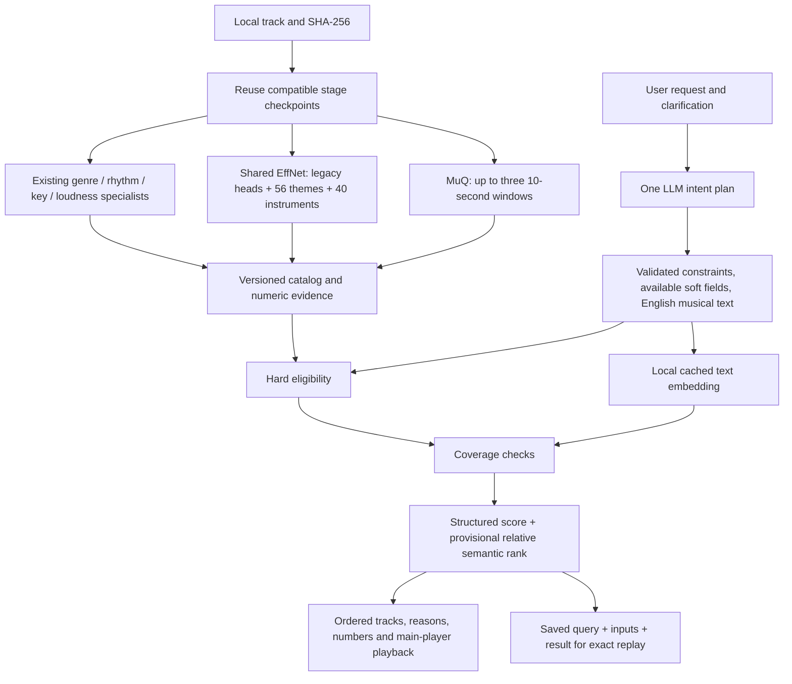

# Estimator upgrade — implementation and evidence

> 2026-09-25 continuation: direct supervised challengers are now implemented and selectable. Read [the new checkpoint](SUPERVISED_ESTIMATORS.md). This September 22 hybrid/MuQ record and its measurements remain historical; the reference profile remains default.

Started 2026-09-22. Research/decision: [full report](research/ESTIMATOR_UPGRADE_2026-09-22.md).

## Work plan

1. Research and choose estimators — complete; choose MuQ-MuLan + expanded EffNet heads; preserve specialist estimators.
2. Pin/setup assets, bounded offline semantic worker, temporal evidence and cache compatibility — complete.
3. Connect planner, catalog, ranking, app and explanations; preserve historical data — complete.
4. Focused tests, two-source acoustic smoke, full pipeline/replay, web checks — complete.
5. Update takeovers, feature policy, schemas, status and logs with measured outcome — complete.

## Chronological evidence

- Research: read the attached report and current implementation; verified official MuQ, Music2Emo, FIGMA, CLaMP3 and Essentia sources. FIGMA is a new candidate beyond the attachment; source explicitly uses global embeddings at inference.
- Read-only research fetch failures: an incorrect CLaMP3 GitHub URL returned 404; one web click call could not resolve stale link IDs; reopening the primary page resolved its links. Default shell network could not resolve GitHub; the explicit approved network fetch succeeded. No source audio was involved.
- Downloaded the two small official Essentia heads and metadata for checksum pinning (about 5.5 MB combined graphs). No inference yet.
- Important implementation finding: current web cache reused any nonfailed semantic stage under the genre policy, so adding heads alone would never upgrade existing complete records. New compatibility checks and an explicit upgrade action are required.

## Evidence limits

No listening-quality claim. No whole-library rerun. Measured source preservation, real model execution and regression outcomes appear below. Historical intermediate entries retain the state at their recording time.

### Checkpoint: expanded heads and software integration

- Added `semantic` implementation `essentia-discogs-effnet-expanded-v3`, keeping all 56 theme and 40 instrument outputs with patch p10/p90 summaries. Mean classifier outputs are not exclusive probabilities.
- Chose `muq-3x10s-v1`: at most three ten-second windows at distributed positions, normalized segment vectors, a 32-description character bank, pinned offline weights/configs/tokenizer. Texts are encoded individually to avoid upstream variable-length padding influencing mean pooling. Official complete state dictionary is loaded strictly, with `weights_only=True` and mmap; auxiliary encoders are instantiated from configs instead of downloading duplicate weights.
- Added typed semantic query/audio evidence, schema 0.3.0 (historical 0.1/0.2 readable), planner v1.4/compiler v1.2 and `hybrid-semantic-v1`. Fusion requires complete compatible **eligible** coverage. Midrank `(lower + 0.5 * tied) / N`, 30% semantic when structured objectives exist, 100% otherwise; negative contrast coefficient 0.25. All are provisional and replayable.
- Actual expanded-head smoke: Ocean 3.169 s / 1254.0 MiB peak RSS; Paradise 2.972 s / 1262.5 MiB. Zero failures; original hashes and full folder inventories unchanged. Outputs under `output/estimator-upgrade/{ocean,paradise}/expanded`. These are runtime checks, not listening verdicts.
- First regression run: 417 passed; two existing watchdog tests could not read macOS swap telemetry inside the sandbox; three version/field expectations needed intentional migration updates. With process access, 437 passed and one remaining schema-version expectation failed. New semantic safety/ranking tests: 16 passed.
- First web run: 76 passed / one historical scene-disclaimer wording assertion failed. Preserved the old disclaimer for old results and use semantic wording only when semantic evidence exists. An earlier npm invocation used the Python package directory by mistake (no package.json); corrected to the web-player directory.

### Live planner failure and pivot

The first three-prompt live smoke is preserved under `output/estimator-upgrade/live-*.json`. The beach request produced an English musical description and exact hybrid replay. The intimate-evening request returned its description in Spanish despite v1.4's English instruction, and chose `mood:warm` despite zero available numeric evidence (correctly reported as partial support). Semantic cosines were weak and the semantic branch preferred the house example; this is not evidence of improved mood accuracy. Do not treat a mechanically successful ranking as a listening success.

Planner v1.5 reinforces language at the end of the prompt and in the field schema, adds a Spanish-to-English example, keeps unsupported nuanced adjectives in the semantic description and avoids inferring literal dataset contexts such as travel/nature/summer merely from a beach setting. Retest follows; no track-specific rule or fabricated judgment is added.


### Closing checkpoint — 2026-09-22

The selected implementation is integrated in the local workflow and app. Model setup is installed on this machine. Two existing sources are upgraded; the remaining library is preserved. No unresolved software test failure remains. Larger coverage and listening acceptance are separate next steps.

- Pinned MuQ-MuLan weights: 2,653,954,401 bytes, SHA-256 `d42ae3f7cb9b66759ee0089ddc70e2f28b130c2d8ba621457358272d32dd0444`. Main revision `2e01c796b71dca71b45251384c04cd7b237c9020`; auxiliary MuQ config `0562a57814f6f8bbd9fdea0a25921a2fce1a841a`; XLM-R tokenizer/config `e73636d4f797dec63c3081bb6ed5c7b0bb3f2089`. Manifest records every asset URL/size/hash. No duplicate backbone weights downloaded.
- `uv sync --locked --extra analysis --extra semantic` succeeded. Semantic dependencies are optional; core contracts/search still do not require Torch. The existing analysis environment remains available.
- Actual MuQ smoke: Ocean **17.33 s / 2600.2 MiB** peak process-tree RSS; Paradise **13.25 s / 2814.9 MiB**. Each has three ten-second windows. Expanded heads took **3.169 / 2.972 s**, with peaks **1254.0 / 1262.5 MiB**. Times are observed stage runs, not expected whole-library throughput or total cold-start estimates.
- Integration validates all new dimensions, retains successful original stages, and verifies SHA-256 before/after. Retrying both sources executes **zero stages**. Chrome's normal one-track actions attached cached upgrades to the existing library without new model work. Analysis and track details show all added evidence; the detail panel was inspected visually at desktop size. No new mobile or listening acceptance is claimed.
- v1.5's three live requests produced English descriptions, but the intimacy case still selected unavailable `mood:warm`. Prompt wording alone did not fix that. **v1.6** restricts the preference schema to nonzero catalog coverage, validates availability locally, and preserves the full enum for explicit hard constraints. The one affected live retest passed: `matched`, **17.8 s**, `hybrid-semantic-v1`, exact full result replay. All seven live calls and prior failures remain saved.
- Final offline replay compares structured versus hybrid on the same two-track catalog for calm beach, intimate evening and dance party. All three fixed-query replays are exact. This is a mechanics ablation, not a quality benchmark; two prompts retain v1.5 plans and one uses v1.6.
- New numeric theme/instrument/valence objectives are removed for all candidates if any eligible track lacks the objective. Semantic coverage likewise requires every eligible candidate, including those below the requested top-k. This prevents partially upgraded records receiving an unfair score advantage.
- Final checks: **442 Python tests, 77 web tests, 45 JavaScript syntax modules, 28-file build verification**. Build: 382314 bytes, manifest SHA-256 `0c417bc697070198c03b101a90ac0d52d400ac15661b54a61832b46ca5c56036`. No source audio is included in the static build.
- Additional fixes: exact-file selection in web analysis; old usable stage preservation on upgrade failure; contribution text regenerated after fusion; short-clip coverage counts the union of overlapping sample intervals; CLI and desktop share the optional local query encoder. Existing pure search remains inference-free.

### Negative findings that remain open

The semantic-only intimacy comparison prefers My Paradise - Edit over Listen Over the Ocean. Final mean positive cosines are −0.1076 versus −0.1358; neither establishes a good match. Structured evidence leaves Ocean first after fusion (34.21 versus 32.03 points), but the semantic branch narrows its lead. Do not claim that the original Manuel/Grecia scene disagreement is solved. No per-track override was introduced.

Ocean's character probes include bouncy 0.066, wistful 0.045 and airy 0.042; intimate is only 0.013. Its mood/theme head assigns Christmas approximately 0.099 despite no supporting listener annotation. These are useful counterexamples to treating model outputs as truth. Final score weights and relative-rank normalization remain provisional. Poor absolute similarity can still receive high relative rank in a poor candidate pool.

## Pipeline and implementation map



| Area | Source of truth |
|---|---|
| Worker setup / pinned model acquisition | `scripts/setup_semantic.py`, `pyproject.toml`, `uv.lock`, `model_assets.py` |
| Bounded MuQ / text cache / probes | `semantic_audio.py`, `analysis_pipeline.py`, `analysis_worker.py` |
| Labels and typed evidence | `extended_labels.json`, `feature_catalog.py`, `models.py` |
| Planner / available-field schema / compiler | `intent.py`, `translators.py` |
| Deterministic scoring and coverage gates | `semantic_ranking.py`, `ranking.py`, `search.py` |
| Integration / exact source / cache preservation | `web_bridge.py`, `service.py`, `cli.py`, `desktop.py` |
| App display | player `features.js`, `match-explanation.js`, `prompt-connection.js`, `app-status.js` |
| Focused regression | `tests/test_semantic_upgrade.py`, `tests/test_intent_iteration1.py`, player `tests/semantic-upgrade.test.mjs` |

Python source paths in the table are under `src/prompt_to_playlist/`; player sources are under `../web-player/src/`. No new model-callable tools are defined. The LLM makes a single structured response; internal local workers and deterministic search execute afterward under application control. Audio and track-level vectors stay local. JSON remains current; the separate YAML evaluation task remains open.

## Setup and use

From `packages/prompt-to-playlist` in this repository:

```sh
uv sync --locked --extra analysis --extra semantic
.venv/bin/python scripts/setup_semantic.py
.venv/bin/python -c 'from pathlib import Path; from prompt_to_playlist.model_assets import ensure_assets, required_assets; ensure_assets(Path("output/estimator-models"), required_assets(["semantic", "energy", "rhythm"]))'
```

These explicit setup commands may download pinned public model assets. They are already completed here. The existing MAEST setup/cache is retained. MuQ inference uses offline mode, pinned local configs/tokenizer and strict full-state loading; analysis never auto-downloads MuQ assets. A missing setup becomes a visible failed stage/fallback. Essentia's existing asset acquisition mechanism remains hash-verified.

Start/reuse the local player with `npm run dev` from `packages/web-player`, keeping `http://127.0.0.1:4173` for the existing Chrome library. **Details → Upgrade / retry analysis** upgrades one selected record; **Analyze Tracks** processes old-version and partial loaded records sequentially. Each action preserves successful compatible stages and source files. The agent did not press the library-wide action.

PlaylistIQ automatically uses semantic fusion when all eligible tracks have compatible vectors. Until then it shows partial support and the structured ranking. Expanded soft fields with incomplete eligible coverage are omitted fairly. The two smoke tracks receive no special production treatment. CLI/desktop prompt entry points can also use semantic catalogs; they do not convert an old metadata-only catalog into analyzed audio. Library callers explicitly pass `query_encoder=encode_query` to `build_playlist` when local inference is desired.

Regression commands (no acoustic inference):

```sh
.venv/bin/python -m pytest -q
```

From `packages/web-player`:

```sh
npm test
npm run check
npm run build
node scripts/verify-build.mjs
```

Reproduction scripts are explicit actions, not startup hooks. `scripts/smoke_estimator_upgrade.py` checks exactly the two authorized hashes and reuses compatible completed checkpoints; if checkpoints are missing it can rerun those two sources. `scripts/smoke_playlist_semantics.py --live --case 2 --output-name UNIQUE_NAME` makes one configured LLM request plus local text inference; omit `--case` for all three. Output directories must be new so old evidence is not overwritten.

## Evidence inventory

All paths below are relative to this package:

- `output/semantic-models/manifest.json`: exact model acquisition identity.
- `output/estimator-upgrade/{ocean,paradise}/expanded/descriptor-run.json`: expanded-head source/telemetry evidence.
- `output/estimator-upgrade/ocean/muq/descriptor-run.json` and `output/web-features/checkpoints/<source-hash>/semantic-audio/run/descriptor-run.json`: MuQ execution/reuse evidence.
- `output/estimator-upgrade/integration-smoke.json`: both sources complete, hashes unchanged, no work on retry.
- `output/estimator-upgrade/live-1.json` through `live-3.json`: v1.4 failures and successful mechanics, preserved.
- `output/estimator-upgrade/planner-v1.5/`: three language retests, including unsupported-field failure.
- `output/estimator-upgrade/planner-v1.6/live-2.json`: final affected-case pass.
- `output/estimator-upgrade/final-replay-ablation.json`: fixed-query structured/hybrid comparison with provenance.
- `output/web-features/playlist-<uuid>.json` and matching `-inputs.json`: exact full run plus catalog/vocabulary/request snapshots; includes prior attempts.
- `output/web-features/<source-hash>.json`, `history/<source-hash>/`: current upgraded evidence and prior cache snapshots.

| Test source | SHA-256 |
|---|---|
| Listen Over the Ocean | `b23cf7fc573254db349ab179fdcc406c5da159186b04b1fe914ff913d83e4ae2` |
| My Paradise - Edit | `c4fa9722112e74661c9a4da26fa386d9a65564da8a3cef25048df25168f31bae` |

## Next evidence, not unfinished implementation

1. Through an explicit authorized library run, fill eligible-track coverage. Preserve the per-stage failure log and successful checkpoint reuse; do not infer permission to analyze another source folder.
2. Run blinded track-level and playlist-level judgments on baseline, expanded labels, semantic-only and hybrid, with both calm and energetic beach interpretations. Keep Manuel and Grecia separate.
3. Measure FIGMA and Music2Emo as challengers on the same examples if the semantic errors persist. Adopt on held-out relevance and measured deployment cost, not headline benchmark scores.
4. Tune fusion, rejection/low-confidence behavior and sampling density only from that evidence. No empirical quality threshold or probability calibration is established yet.

### Final packaging check

Offline dependency-lock validation resolved 88 packages. Wheel and source distribution build succeeded; the wheel contains semantic runtime, ranking and exact label metadata. All three new report/guide files have valid local links. This adds no new inference or provider request.
