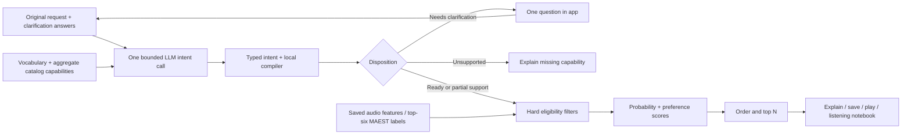

# PlaylistIQ Iteration 1 — implementation and verification

Updated 2026-09-19. Owner request: fully implement the first planner/retrieval improvement in the local workflow and app.

## Delivery checkpoint

- [x] Intent contract, strict structured output and local compiler.
- [x] MAEST probability ranking, taxonomy families, genre alternatives and directional priorities.
- [x] Web clarification and explanation flow, CLI clarification input, native desktop continuation.
- [x] Twenty-prompt listening suite and reproducible saved-feature evaluation runner.
- [x] Complete regression/live/browser verification and record findings.
- [x] Final documentation and project-board synchronization.

Human listening acceptance is separate from software completion. No human verdict has been generated by the agent.

## Pipeline



## Verification history

Baseline: 392 passed, one expected query-contract assertion needed updating, and two macOS telemetry tests failed under sandbox restrictions. The latter pass with normal macOS runtime access (20/20 pipeline tests); no production telemetry behavior was weakened.

Initial live attempts could not reach the provider from the restricted shell; preserved in `output/iteration1-creative-live.json`. With network access, the first prompt revision handled picnic and recipient clarification but generated invalid hard mood/energy OR groups for party and heartbreak. Local validation blocked both. `output/iteration1-validation-diagnostic.json` preserves the rejected proposals. Prompt revision `playlist-intent-v1.1` adds explicit empty-constraint examples and a genre-only OR rule. Its four creative checks all return supported dispositions: picnic/heartbreak partial drafts, party draft, mom clarification. See [final verification](evaluations/ITERATION_1_VERIFICATION.md) for later repeated-run findings and the final low-reasoning/compiler checks.

## What changed

### 1. Probability-aware selection

`ranking.py` owns `maest-intent-v1`. Filtering happens before scoring; ordering happens before returning the requested maximum count.

- The six strongest MAEST labels remain the eligibility set. All 519 values remain in the feature cache. There is no new threshold, softmax, renormalization of the 519 outputs, or label correction from listening notes.
- A required genre now contributes its raw MAEST support to relevance. Two qualifying house tracks with supports 0.70 and 0.15 no longer tie at 1.0.
- When several selected labels map to the same requested style, use **maximum** support. An OR genre group also uses maximum support. A parent family uses the maximum support among its selected descendants. These are support estimates, not calibrated probabilities for the broad family.
- `discogs-parents-v1` maps the parent segment of the original `Parent---Style` label to a supplied family descriptor. It does not invent arbitrary semantic neighbors or promote a seventh-ranked label. Exact legacy matching remains available.
- Hard required tags combine with AND. Every `any_tag_groups` group must have at least one categorical genre match. Explicit exclusions still require complete evidence on the relevant axis. A missing top-six label cannot prove “no techno.”
- Each soft preference has `increase` or `decrease`, `primary`/`secondary`/`optional`, and `explicit`/`inferred` origin. Code sets importance to 3/2/1. The LLM cannot write a numeric scoring weight.
- If explicit genre objectives and other preferences are both available, allocate 65% to genre and 35% to other preferences. Normalize priorities within each group. A sole available group receives 100%. Inferred genre preferences share the ordinary preference group.
- For an available estimate `p`, increase utility is `p`; decrease utility is `1-p`. A missing/rejected estimate receives zero utility in either direction. Its `evidence_value` remains null, distinct from a measured zero. Keep a fixed denominator across tracks.
- A preference with no usable evidence anywhere in the catalog is excluded from scoring with an explicit warning; a returned draft becomes partial support. Hard constraints are never removed this way.
- Each result records the evidence value, utility, normalized weight, contribution, origin, source label, eligible IDs, taxonomy/ranking versions and input digests. Scores are rounded to six decimals; contribution sums reproduce them within rounding tolerance.
- Relevance ties use stable track IDs. An explicitly requested BPM order sorts the eligible pool by BPM before taking top N; relevance breaks BPM ties. Missing BPM cannot pass numeric bounds.

The 65/35 blend, 3/2/1 priorities and existing arousal mapping are provisional engineering choices. Their presence is not evidence of listener preference or improved musical quality.

### 2. Intent planner and compiler

Source: [`intent.py`](../src/prompt_to_playlist/intent.py); exact current prompt: [INTENT_PROMPT.md](INTENT_PROMPT.md).

`OpenAITranslator.translate_intent` makes one Responses request per submission. The model is still the configured `gpt-5.4-mini-2026-03-17`. Prompt version is `playlist-intent-v1.3`; plan schema is `playlist-intent-v1`; compiler is `intent-compiler-v1.1`. The project explicitly sets `intent_reasoning_effort = "low"`; generic library callers may leave this unset for model compatibility. This setting applies to intent planning, not the preserved v3 baseline. The selected model supports low reasoning ([official model documentation](https://developers.openai.com/api/docs/models/gpt-5.4-mini)); the repeated-case evidence, rather than the documentation, motivated using it here. The API gets the original request, up to three question/answer pairs, the vocabulary and aggregate capability counts. It does not receive audio, catalog titles/IDs, paths or per-track feature vectors. The ordinary request/answer text is necessarily sent as provided; avoid putting unrelated private data in it.

The strict schema requires every field (nullable where appropriate) and forbids additional properties. One shared descriptor enum avoids tripling hundreds of genre IDs in the schema. The response parser rejects duplicate keys, nonfinite numbers, refusals, truncation, unexpected output items and multiple text payloads. There are no automatic retries, fallback providers or agent loops.

The plan records a concise public interpretation, occasion/activity/recipient/emotional goal, explicit constraints, preferences, assumptions and gaps. This is an inspectable intermediate plan inspired by the useful architectural aspect of composer-agent work; it does not request or save private chain-of-thought. JSON remains the runtime format.

The raw proposal is retained separately as `proposed_plan`; `plan` is the normalized plan. The compiler collapses duplicate same-direction preferences without multiplying their weight: explicit intent takes precedence, then higher importance. Opposite directions still fail. A paraphrased quote on an inferred preference becomes null with a warning; explicit source quotes remain strict. The compiler revalidates the plan and vocabulary, rejects unsupported/contradictory query fields, and checks that explicit sources are literal spans of the original request or an answer. A clarification question is not evidence of user intent. Numeric BPM bounds must occur in the quoted span. Non-default count and order require source spans. Unsupported hard gaps cannot be silently accepted as optional. These checks enforce structure and anchoring, not perfect semantic truth: an LLM can still misunderstand a valid quote. The benchmark and listening notebook remain necessary.

Disposition behavior:

| Plan/result | Behavior |
|---|---|
| `ready` | Compile, filter, rank and return draft. |
| `partial_support` | Return supported draft with gaps/warnings. |
| `needs_clarification` | No retrieval; display one question. |
| `unsupported` | No retrieval; explain missing capability. |
| `no_matches` | Valid query, but no track satisfies its hard filters. |

Ordinary creative prompts receive soft musical assumptions. Recipient alone prompts a taste/mood question. “Heartbroken” can use acoustic sadness; “only lyrics about a breakup” is unsupported. A familiarity preference is disclosed as unavailable, not translated into warmth or happiness. This release handles clarification, not unrestricted conversational playlist editing.

### 3. App and workflow integration

- **Web:** Open PlaylistIQ, describe the situation and press Find tracks. Inspect the interpretation, optional assumptions and limitations. Answer the inline question if shown. Edit the original text to start a fresh request. Save stores ranked IDs in ordinary playlists, so existing playback/queue behavior applies.
- **Details:** Expand “Plan, structured query and score evidence” for the exact plan/query and per-track contributions. “Why this track” gives the scoring explanation without exposing a reasoning transcript.
- **Listening lab:** P01–P10 are preserved. P11–P20 add picnic, party, heartbreak, mom, alternatives, reduced aggression, lyrics, Spanish context, explicit ordering and optional familiarity. Each attempt preserves original prompt, answers, full run/error, candidate hashes, timing and an independently entered verdict/notes. Nothing auto-assigns a human verdict.
- **Persistence:** The current draft survives navigation within a loaded page. Reload resets the draft; saved playlists and the browser notebook persist. Storage failure is reported and the notebook still supports export. The isolated acceptance fixture uses its own test origin and generated tones.
- **Python service:** `build_playlist(..., clarifications=[ClarificationAnswer(...)])` uses intent planning when supported by the translator. Existing rules/stub translators retain the legacy path.
- **CLI:** `prompt --text 'Music for my mom.' --clarifications answers.json ...` accepts a JSON array of `{ "question": "...", "answer": "..." }`, maximum three. Keep `--text` as the original request. Normal result JSON contains the new interpretation and query.
- **Native desktop:** Press Find tracks again on a clarification result to answer the question in a dialog; editing the original description starts a new request. The details view explains OR groups and directional preferences.
- **Local bridge:** Browser request validation bounds prompt, candidate IDs/hashes and answer history. Python reads existing feature-cache JSON. Each completed request writes `playlist-<uuid>.json` plus `playlist-<uuid>-inputs.json` with the exact request/catalog/vocabulary for local replay. Browser exports also keep candidate identities. These local snapshots may contain private library metadata and should not be published blindly.

## Structured query example

```json
{
  "required_tags": [],
  "preferred_tags": [],
  "excluded_tags": [],
  "min_bpm": null,
  "max_bpm": null,
  "limit": 8,
  "excluded_track_ids": [],
  "order": "relevance",
  "any_tag_groups": [["genre:rock", "genre:pop"]],
  "preferences": [],
  "genre_scope": "taxonomy"
}
```

This means “up to eight tracks matching rock OR pop,” with MAEST support determining relevance. A party request instead usually has no hard tags or BPM bounds and uses primary increase preferences for danceability and energy. See [example run](evaluations/iteration1-example-run.json).

## Tools and compatibility

There are still exactly three allowlisted deterministic operations: `normalize_descriptors` v1, `search_tracks` v2 and `get_tracks` v1. The new planner does **not** receive any tool definitions and cannot call them. Local code invokes retrieval after validation. No SQL is generated.

Python package 0.4.0 and web player 0.3.0 deliver this iteration. New catalog/translation/result/run objects write schema 0.2.0; readers still accept historical 0.1.0. The vocabulary wrapper remains 0.1.0; its identity now includes the taxonomy version. Query additions default to empty preferences/groups and exact genre scope when reading old inputs. Existing files are not rewritten. Older clients that enforce 0.1.0 must upgrade before consuming new exports.

`OpenAITranslator.translate()` retains the v3 flat-query route for explicit baseline comparison. `search_tracks(..., ranking_version="legacy")` replays the older ranking algorithm only for legacy-compatible queries; it rejects modern fields instead of silently ignoring them. Replaying in the new package is an algorithm comparison, not a promise of byte-identical historical result IDs.

## Reproduction

From `packages/prompt-to-playlist`:

```sh
.venv/bin/python -m pytest -q
.venv/bin/python -m prompt_to_playlist.evaluate_intent --live --limit 20 --out output/iteration1-live.json
```

The second command explicitly makes bounded provider calls. It reads saved feature JSON only; it never opens audio or runs analysis. The checkpoint file is rewritten after each case so interrupted evaluations retain completed attempts. Its genre ablation compares old/new ranking with identical queries and catalogs. `benchmark.py` checks intent and retrieval behavior independently of a human listening verdict.

The maintained prompt source is the web lab's `reviewPrompts`; its checked-in export is `docs/evaluations/iteration1-prompts.json`. Regenerate after suite changes:

```sh
node --input-type=module -e "import {reviewPrompts} from '../web-player/src/playlist-review.js'; console.log(JSON.stringify({version:'playlistiq-iteration1-v1',cases:reviewPrompts},null,2))" > docs/evaluations/iteration1-prompts.json
```

From `packages/web-player`, run `npm test`, `npm run check`, `npm run build`, and `node scripts/verify-build.mjs`. `node scripts/serve-playlistiq-qa.mjs` serves the isolated presentation fixture at `http://127.0.0.1:4188`; it uses recorded plans and generated audio, with no provider requests. Test question → answer → save → play → reload, then inspect the notebook and narrow layouts. This is presentation/playback acceptance, not a music-quality assessment.

For the user's existing library, retain the same browser, hostname and port. Restart the local player server to load the Node request validator, then reload the existing tab to load the new frontend. A new test port has a separate browser library.

## Remaining evaluation, and Iteration 2

Listen to results from a fixed library and record whether each interpretation and playlist fits. Accept or tune the provisional weights with evidence, not assumptions. Unknown lyrics/familiarity/personal taste, incomplete negative evidence and inaccurate acoustic estimates remain limitations. The broader retrieval, embeddings/CLAP, diversity, personalized preferences and general iterative refinement belong to Iteration 2. PIQ-020 / LATER-PIQ-YAML remains a consideration task; serialization was not migrated.

## Final result

Software implementation is complete. Verification: 422 package tests, 50 web tests, production manifest validation, final live clarification/HTTP checks and 20/20 behavioral checks on final compiler replay. The low-reasoning live batch initially passed 19/20; duplicate preference normalization resolved the remaining case and a subsequent live check passed. [Full evidence and limitations](evaluations/ITERATION_1_VERIFICATION.md). Listening acceptance remains open.
