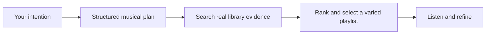

# Better PlaylistIQ playlists: the digest

**17 September 2026 · Summary of the [full research report](PLAYLIST_PLANNER_RESEARCH_2026-09-17.md)**

## My recommendation

Improve PlaylistIQ in two layers:

1. **Rank tracks using the musical evidence we already have**, starting with MAEST genre scores.
2. **Interpret the experience the user wants**, then search for music that can support it.

The best next design is a structured intent planner, followed by local retrieval and playlist selection. A better prompt helps, but it cannot compensate for discarded probabilities or missing information about lyrics and personal taste.

This is a research recommendation. The runtime has not changed in this pass.

## 1. Your genre-ranking observation is correct

We currently retain MAEST probabilities but ignore them in ranking. For a genre-only request, all eligible tracks receive the same score, and stable IDs break the tie.

For an illustrative House query:

| Track | MAEST House score | Current score |
|---|---:|---:|
| A | 0.91 | 1 |
| B | 0.24 | 1 |
| C | 0.65 | 1 |

The first improvement should return **A → C → B**, then take the requested number. It must work when House is a requirement, not just a preference.

Initially retain top-six genre eligibility so we can measure the ranking change cleanly. Test broader taxonomy matching and all-519 soft retrieval separately. A MAEST score indicates model evidence; it is not the chance that you will enjoy the track.

## 2. Everyday prompts should describe an experience

| Your prompt | A useful first interpretation | What the system should avoid |
|---|---|---|
| Picnic with my girlfriend | Relaxed, pleasant music that leaves room for conversation | Assuming a genre, exact BPM or her taste |
| Birthday party at night to make the room dance | Prioritize danceable rhythm and lively energy; allow genre variety | Assuming every party means Techno or EDM |
| Heartbroken after a breakup | Reflective or cathartic music, with a choice to lean into sadness or move toward comfort | Claiming sad-sounding tracks have breakup lyrics |
| Music for my mom | Ask for one artist/song she enjoys, or offer a clearly generic draft | Assuming mothers share an age, culture or taste |

These should be correctable starting points. “Less aggressive,” “more playful,” “more familiar,” or a seed song can refine the result without forcing users to learn audio terminology.

The planner should separate **what you explicitly asked for**, **what it inferred**, and **what the catalog cannot verify**. Ordinary creative requests should usually produce a useful draft; one focused question is appropriate when the missing information determines the direction.

## 3. The strongest architecture

The plan captures occasion, activity, emotional goal, recipient, explicit constraints, soft preferences and assumptions. The search combines:

- MAEST genre scores and existing audio features.
- Grounded track descriptions for keyword/meaning search.
- A later tested music–text embedding channel for subtler acoustic descriptions.
- Taste anchors and manual-playlist patterns when real evidence exists.

Then selection avoids needless repetition while respecting the request. This remains playlist creation; smooth mixed transitions are a separate capability.

Deezer's deployed Text2Playlist is the closest research precedent: intent extraction, catalog retrieval, personalization and refinement. Its richer data and scale mean we should borrow the architecture without expecting its results automatically. [Primary paper](https://earl-workshop.github.io/pdf/recsys2025-workshops_paper_16.pdf).

## 4. What ACE-Step 1.5 teaches us

Its trained Composer Agent creates structured musical metadata before audio generation. ChatML formats messages; YAML expresses metadata fields; constrained decoding helps enforce their structure. The useful lesson is **plan first, execute through a controlled interface**.

The paper does not show that YAML beats JSON or that asking for chain-of-thought improves playlist retrieval. We should store a concise musical plan and its assumptions, not a long reasoning transcript. [ACE-Step paper](https://arxiv.org/html/2602.00744v1), [official implementation](https://github.com/ace-step/ACE-Step-1.5/blob/main/acestep/llm_inference.py).

## 5. Which methods deserve effort?

| Priority | Method | Why |
|---|---|---|
| First | MAEST-weighted ranking | Fixes a confirmed loss of useful information; no new analysis needed |
| Next | Rich intent plan + current features | Makes creative requests expressible and auditable |
| Then | Grounded text retrieval and music–text embeddings | Tests whether better representations improve subtle matching |
| After that | Diversity, refinement and personalization | Improves the playlist as a whole and adapts to actual taste |

CLAP's music checkpoint is a practical first embedding candidate; MuQ-MuLan is a larger music-focused challenger. Neither has been benchmarked on this Mac or these prompts. The full report records their configurations, licenses and limitations.

I would defer training our own recommender, reinforcement learning and complex agent teams. We first need evidence about where the current system fails and whether simpler changes fix it.

## 6. YAML is on the to-do list

Added **“Evaluate YAML versus JSON between modules”** to the project board as `PIQ-020`, with a matching action in Later.

My current preference: standardize the typed contract first, retain JSON for machine communication, and test YAML as a readable view of the same plan. Compare validation, model output reliability, token counts, parsing, audit hashes and migration cost before deciding. No format migration has been made.

## How we will know it works

Compare the current system, probability-aware ranking, richer planning and semantic retrieval separately, on the same library and a held-out set of creative prompts. Judge both individual tracks and complete playlists by listening. Record wrong assumptions, missing evidence and hard-constraint violations alongside relevance and latency.

**The next concrete build should be MAEST-weighted ranking. The next design change should be a richer intent plan.** The [full report](PLAYLIST_PLANNER_RESEARCH_2026-09-17.md) includes formulas, a proposed planner prompt and schema, source-by-source assessments, evaluation design and implementation slices.
